# Credit Score Prediction using Machine Learning

[](https://credit-score-predictor-nskvgteb6aui4iog8lezda.streamlit.app/)


Predicting a customer's credit score from behavioural and demographic features using a tuned Extra Trees regressor, with a full validation pipeline and an interactive Streamlit app.

**Course:** Computational Intelligence, T.Y. B.Tech E&TC
**Author:** Harsh Katheria

> **Live demo:** [Open the Streamlit app](https://credit-score-predictor-nskvgteb6aui4iog8lezda.streamlit.app/)
> The app may take a few seconds to wake up if it has been idle.

---

## Highlights

- Benchmarks 4 models with cross-validation: Dummy baseline, Ridge Regression, Random Forest, Extra Trees
- Tunes the best model (Extra Trees) with grid search
- Reaches **R² = 0.904** and **MAE = 16.84** on a held-out test set
- Explains the model with permutation feature importance
- Checks error by subgroup (age group, card type, gender, occupation)
- Auto-generates 300-DPI poster charts and a model card
- Includes a Streamlit app for live predictions

## 1. Problem Statement and Objective

Credit scoring decides who gets credit and on what terms. The objective is to predict a continuous credit score from customer behaviour and profile features, and to check how well the model generalises, which features drive it, and where it makes larger errors.

## 2. Dataset Overview and Data-Quality Audit

| Property | Value |
|---|---|
| Source | Synthetic credit card customer behaviour dataset |
| Rows used in this repo | 5,000 sample (full dataset: 50,000 rows) |
| Columns | 30 |
| Missing values | 0 |
| Duplicate rows | 0 |

The repo ships a 5,000-row sample because the full 50,000-row run produces a model file above GitHub's 100 MB limit. A feature formula audit (`outputs/feature_formula_audit.csv`) records how each feature is built.

## 3. Exploratory Data Analysis

<table>
  <tr>
    <td align="center">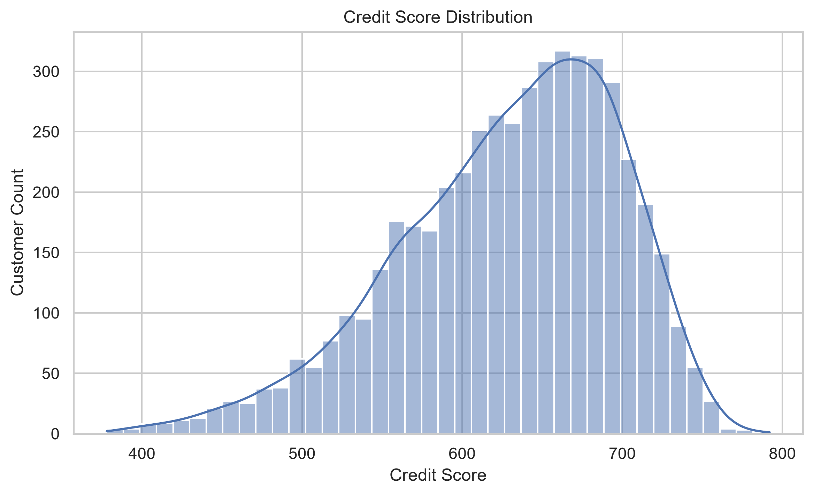<br><sub>Target distribution</sub></td>
    <td align="center">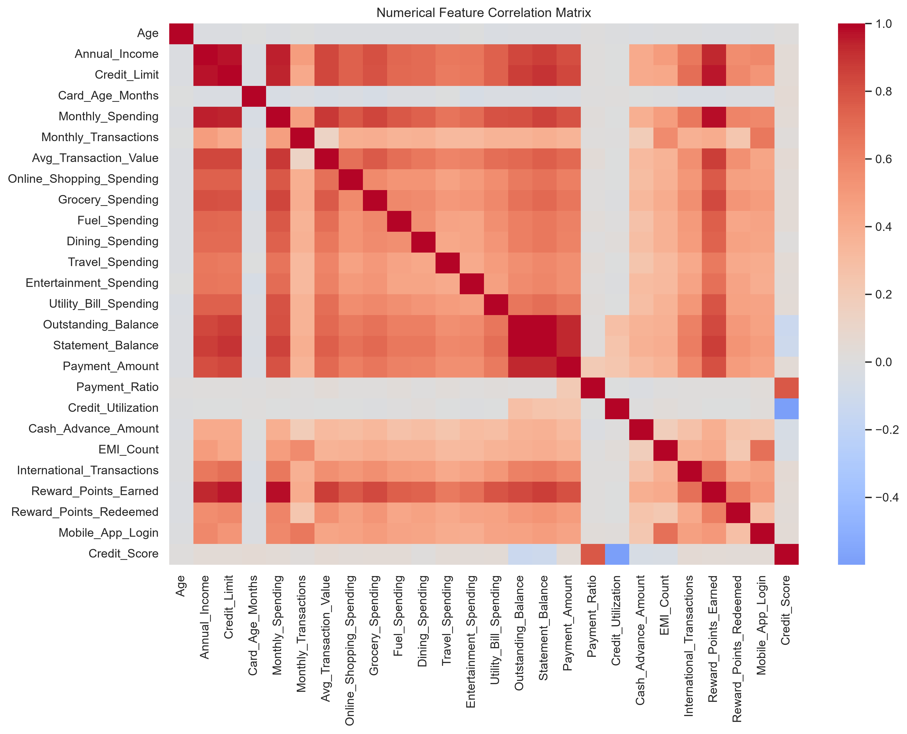<br><sub>Correlation heatmap</sub></td>
  </tr>
  <tr>
    <td align="center" colspan="2">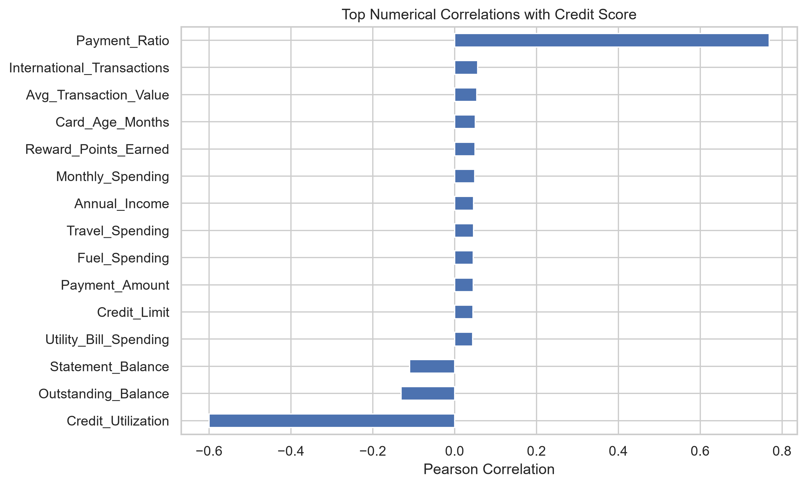<br><sub>Features most correlated with the target</sub></td>
  </tr>
</table>

## 4. Methodology and Validation Strategy

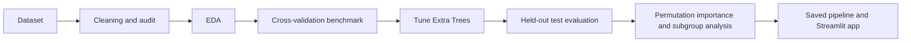

- Train/test split with a held-out test set that is never used for tuning
- Cross-validation to compare models fairly
- Grid search (3 folds, 6 candidates) to tune the best model
- One saved scikit-learn pipeline so preprocessing and model travel together

## 5. Cross-Validation Model Benchmark

| Model | CV MAE | CV RMSE | CV R² |
|---|---|---|---|
| **Extra Trees** | **19.00** | **24.50** | **0.872** |
| Random Forest | 19.59 | 25.29 | 0.864 |
| Ridge Regression | 45.06 | 57.20 | 0.302 |
| Dummy Baseline | 55.22 | 68.50 | 0.000 |

<p align="center">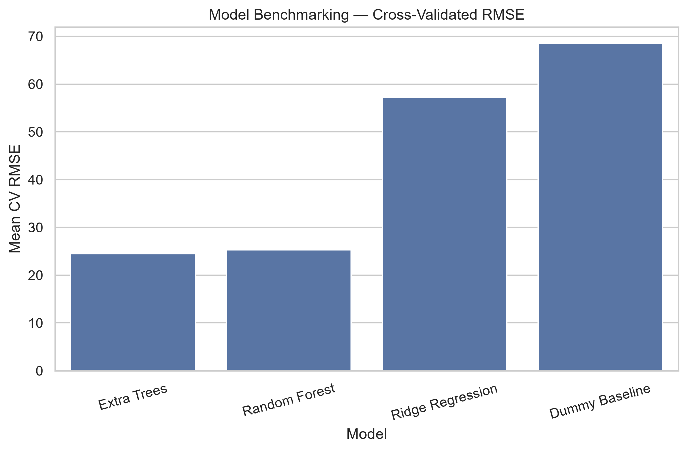</p>

Tree ensembles clearly beat the linear model, which suggests the relationship between features and credit score is non-linear.

## 6. Final Test Metrics

| Metric | Value |
|---|---|
| MAE | 16.84 |
| RMSE | 21.61 |
| R² | 0.904 |
| Median Absolute Error | 13.62 |
| Tuned CV RMSE | 24.48 |

Results can shift slightly between runs. On the full 50,000-row dataset the same pipeline reached R² = 0.945 and RMSE = 16.06, so more data helps.

## 7. Actual vs Predicted and Residual Diagnostics

<table>
  <tr>
    <td align="center">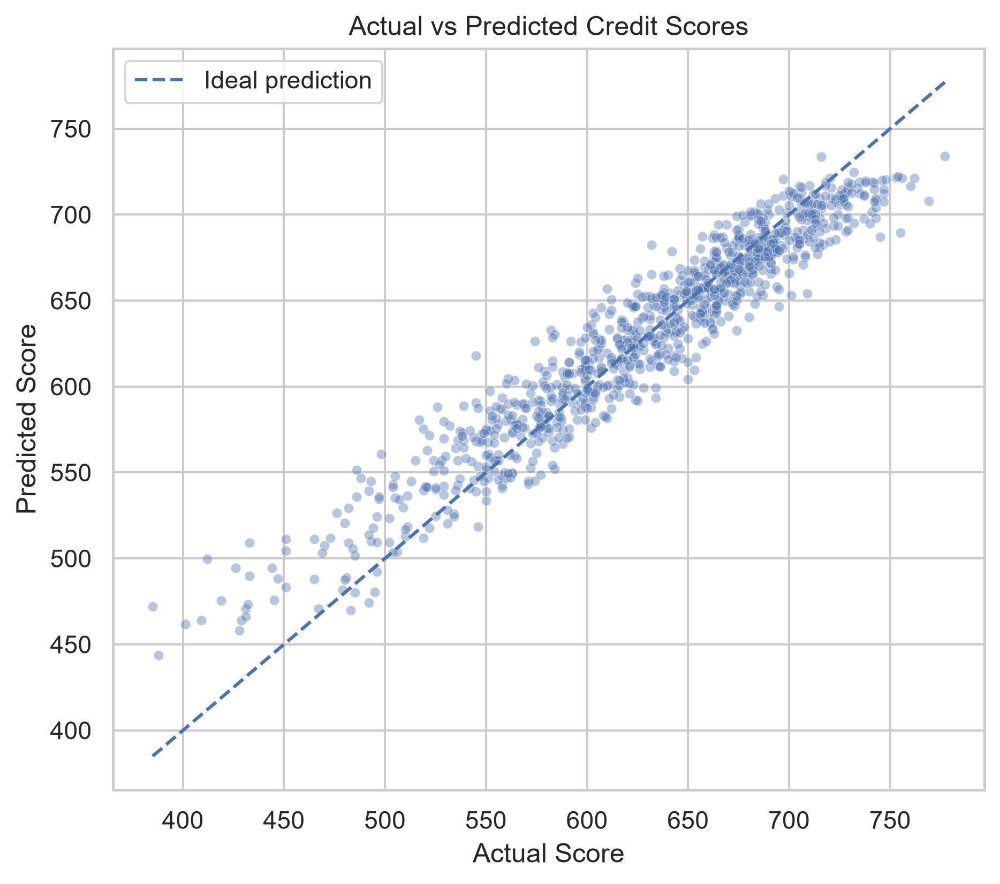<br><sub>Actual vs predicted</sub></td>
    <td align="center">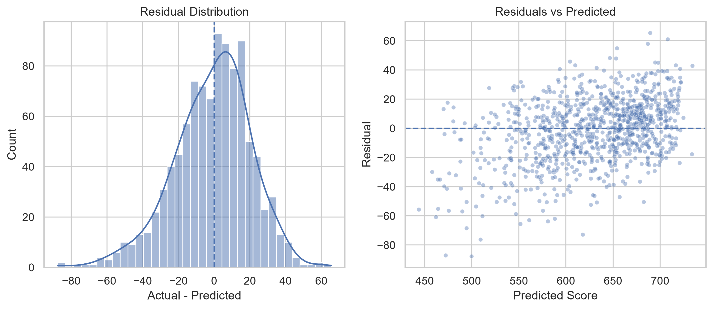<br><sub>Residual diagnostics</sub></td>
  </tr>
</table>

## 8. Permutation Feature Importance

<p align="center">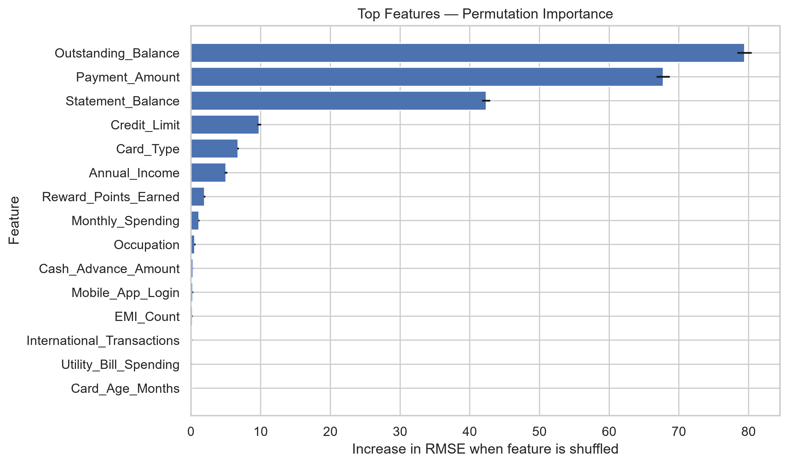</p>

Permutation importance measures how much the test error rises when a feature is shuffled. Full values are in `outputs/permutation_importance.csv`.

## 9. Subgroup Error Diagnostics

<table>
  <tr>
    <td align="center">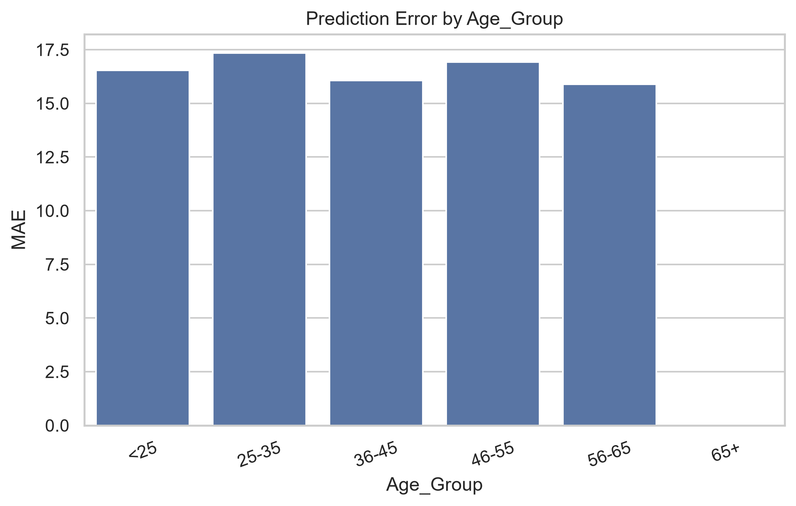<br><sub>Age group</sub></td>
    <td align="center">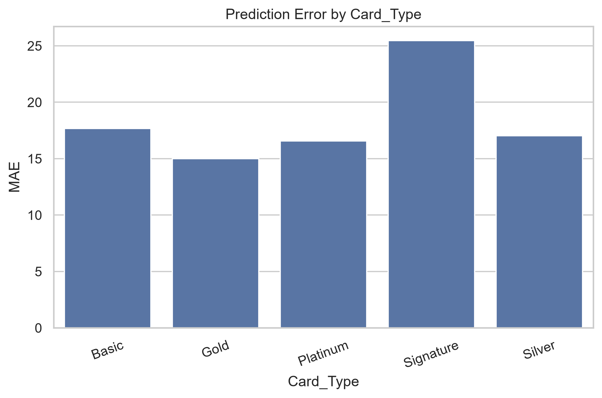<br><sub>Card type</sub></td>
  </tr>
  <tr>
    <td align="center">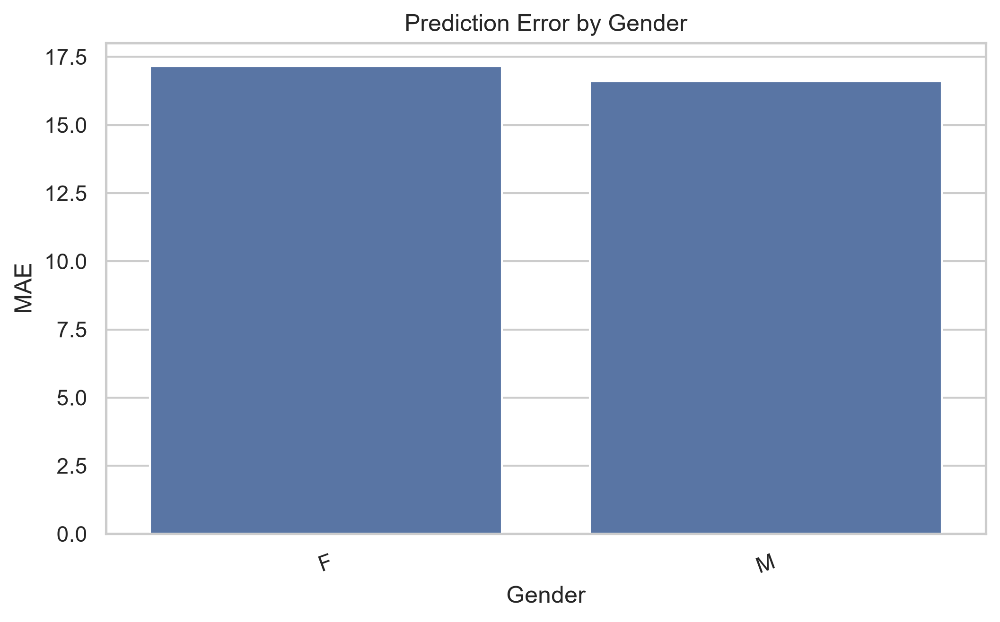<br><sub>Gender</sub></td>
    <td align="center">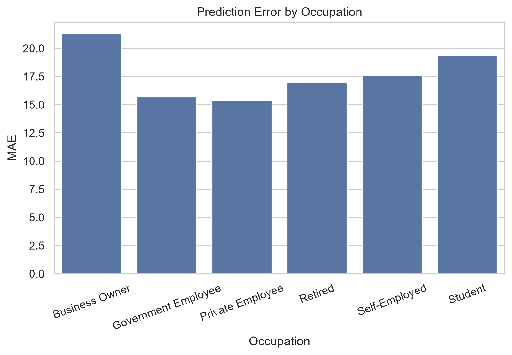<br><sub>Occupation</sub></td>
  </tr>
</table>

These plots show where prediction error is higher or lower across groups. They are a diagnostic, not a full fairness audit.

## 10. Limitations and Future Scope

**Limitations**
- The dataset is synthetic. Strong results here do not establish performance on real customers.
- This is an academic prototype, not a validated lending model.
- Feature formulas and prediction-time availability should be verified before making real-world claims.
- The repo uses a 5,000-row sample, so numbers differ slightly from the full-data run.

**Future scope**
- Validate on real, anonymised credit data
- Try gradient boosting models (XGBoost, LightGBM) and compare
- Add SHAP explanations for per-prediction reasoning
- Run a proper fairness audit across protected groups
- Calibrate prediction intervals, not just point estimates

## Project Structure

```
.
├── app.py                              # Streamlit app
├── main.py                             # Training and evaluation pipeline
├── requirements.txt
├── synthetic_credit_card_customer_behavior_dataset.csv
└── outputs/
    ├── credit_score_prediction_pipeline.joblib
    ├── cross_validation_benchmark.csv
    ├── final_test_metrics.csv
    ├── feature_formula_audit.csv
    ├── target_correlations.csv
    ├── permutation_importance.csv
    ├── subgroup_error_analysis.csv
    ├── test_predictions.csv
    ├── model_card.json
    ├── poster_results_summary.txt
    └── poster_assets/                  # 300-DPI charts
```

## Setup (Windows)

Requires Python 3.11 or newer (tested on 3.12).

```powershell
py -m venv .venv
.venv\Scripts\Activate.ps1
python -m pip install --upgrade pip
pip install -r requirements.txt
```

If PowerShell blocks activation, use Command Prompt: `.venv\Scripts\activate`

## Usage

**Run the pipeline**

```bash
python main.py            # full run
python main.py --quick    # faster run
python main.py --data "C:/path/to/your_dataset.csv"   # custom dataset path
```

**Run the Streamlit app**

```bash
python -m streamlit run app.py
```

Then open http://localhost:8501, or use the [live demo](https://credit-score-predictor-nskvgteb6aui4iog8lezda.streamlit.app/).

## License and Disclaimer

For educational use. Not financial advice and not for real lending decisions.